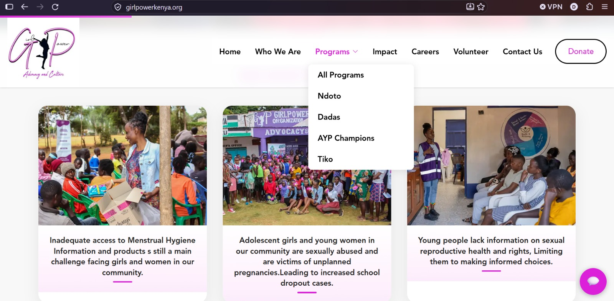

# Hi, I'm Wycliffe Cheruiyot 👋

**Software Engineer — AI Evaluation, Full-Stack and LLM-Integrated Systems**
Nairobi, Kenya ·

I write evaluation tasks for frontier AI models and build full-stack and
LLM-integrated systems.

📫 wycliffearapcheruiyot@gmail.com · [LinkedIn](https://www.linkedin.com/in/wycliffearapcheruiyot) · +254 791 775 477

---

## About

Since October 2025 I've worked as an independent contractor with **AfterQuery**,
writing evaluation tasks with reference solutions, test harnesses and weighted
rubrics, then hardening them until failures show real reasoning gaps rather
than ambiguity or a flawed test. The work covers:

- **PyTorch and JAX kernel correctness**, with behavioural test harnesses that check output against a reference solution
- **Software engineering tasks built from real repository bugs**, with reproducible test suites and reference patches, so each task fails before the fix and passes after
- **Long-horizon business and analytical decision tasks**, with weighted rubrics built to be deterministic and hard to game
- **Adversarial test cases** that catch scoring bugs before they reach production grading

Alongside that, I'm the volunteer IT Lead at **Girlpower Organisation Kenya**
(since 2022), where I built and maintain their content-managed platform. In
2024 I did an IT attachment at **Kenya Power**, where I led a prototype
retrieval-based support chatbot that I later grew, on my own, into the
seven-service portfolio project below.

---

## Stack

| | |
|---|---|
| **Languages & ML** | Python, TypeScript/JavaScript, PyTorch, JAX |
| **Frameworks** | Next.js, React, Vite, Tailwind, FastAPI |
| **AI & Evaluation** | Evaluation task design, weighted rubric design, behavioural test harnesses, adversarial test cases, Docker-based eval environments, RAG and embeddings |
| **Data & Infrastructure** | MongoDB Atlas, Docker, Vercel, Netlify, Render, Cloudinary, Cloudflare Tunnel, Hugging Face, Kaggle GPU (on-demand inference), Paystack, Git |

---

## Featured Projects

### 🧪 Electronics Line Quality Comparison
*Personal portfolio evaluation task — not client work, and not delivered to AfterQuery.*

I built this to show how I design graders. The agent gets a 10,020-row defect
log plus QC, downtime, schedule, capacity and shift-note files, and must pick
which of two production lines gets capital investment. The crux is
**Simpson's paradox**: blended figures make Line A look worse, but it wins on
both product variants once the mix is accounted for.

- Deliberate distractors in the data
- Docker environment, reference solution and verifier
- 46-item weighted rubric with negative-weight penalties
- Golden checks: an empty attempt must score 0 and the reference solution must score 1.0
- Rubric iterated to fix edge cases and scoring bugs

**[electronics-line-quality-comparison →](https://github.com/wycliffearapcheruiyot/electronics-line-quality-comparison)**

> My AfterQuery task work is kept private under client contract terms.

---

### 🔌 KPLC Chatbot System
*Personal portfolio project — my own work, not used by Kenya Power.*

A retrieval-augmented support chatbot for Kenya Power customers, built as
**seven cooperating services**: web, admin, gateway, GPU inference, dataset
sync, knowledge-base builder and MongoDB Atlas setup.

It runs **Qwen3-4B-Instruct** on a Kaggle GPU notebook that starts on demand
and shuts down after 15 idle minutes, keeping hosting cost near zero. The
tradeoff: the first message after inactivity takes about 3 minutes.

> **Heads up:** the first message after a quiet period wakes a cold GPU and takes about 3 minutes. Later replies are fast.

**[Try it live →](https://kplc-chatbot-frontend.vercel.app/)** · [Source](https://github.com/wycliffearapcheruiyot/kplc-chatbot-system)

---

### 🌍 Girlpower Organisation Kenya — Website & CMS
Volunteer IT Lead · Feb 2022 – Present

A content-managed platform I designed and built from scratch for a nonprofit
in Bungoma County: a **Next.js 16 and TypeScript** site on Vercel, a
**React and Vite** admin app on Netlify, and a **FastAPI and MongoDB Atlas**
API, with Cloudinary for media and Paystack for donations.

- Non-technical editors can edit every page, build programme pages from blocks, restore any earlier version, manage users and roles, and publish with one click
- Admin forms are generated from the API's JSON schemas, so a new field needs no admin code change
- Designed for free tiers: the site retries requests while free hosting wakes up, and every edit is saved as a revision because the free database has no automatic backups
- Security: login rate limiting, a honeypot field on forms, short-lived upload signatures and a webhook secret

**[Visit the live site →](https://girlpowerkenya.org)**

<!--GIRLPOWER_SCREENSHOT:START-->

<!--GIRLPOWER_SCREENSHOT:END-->

> **Note on the source:** this is a live system handling a real nonprofit's
> data (staff logins, volunteer records), so the codebase is private. I'm
> happy to walk through the architecture and code directly in an interview.

---

## Latest Activity
<!--LATEST_PROJECTS:START-->
- **[wycliffearapcheruiyot](https://github.com/wycliffearapcheruiyot/wycliffearapcheruiyot)** — Profile README  
  _last pushed 2026-09-24_
- **[kplc-chatbot-system](https://github.com/wycliffearapcheruiyot/kplc-chatbot-system)** — Overview and architecture map of the KPLC chatbot system  
  _last pushed 2026-09-24_
- **[kplc-chatbot-db-infra](https://github.com/wycliffearapcheruiyot/kplc-chatbot-db-infra)** — MongoDB Atlas setup for the chatbot system shared state  
  _last pushed 2026-09-24_
- **[kplc-chatbot-kb-builder](https://github.com/wycliffearapcheruiyot/kplc-chatbot-kb-builder)** — Builds and verifies the chatbot knowledge-base data  
  _last pushed 2026-09-24_
- **[kplc-chatbot-dataset-sync](https://github.com/wycliffearapcheruiyot/kplc-chatbot-dataset-sync)** — Keeps the model dataset synced from Hugging Face to Kaggle on demand - FastAPI  
  _last pushed 2026-09-24_
<!--LATEST_PROJECTS:END-->

---

Last updated: <!--LAST_UPDATED:START-->2026-09-24 22:17 UTC<!--LAST_UPDATED:END-->
